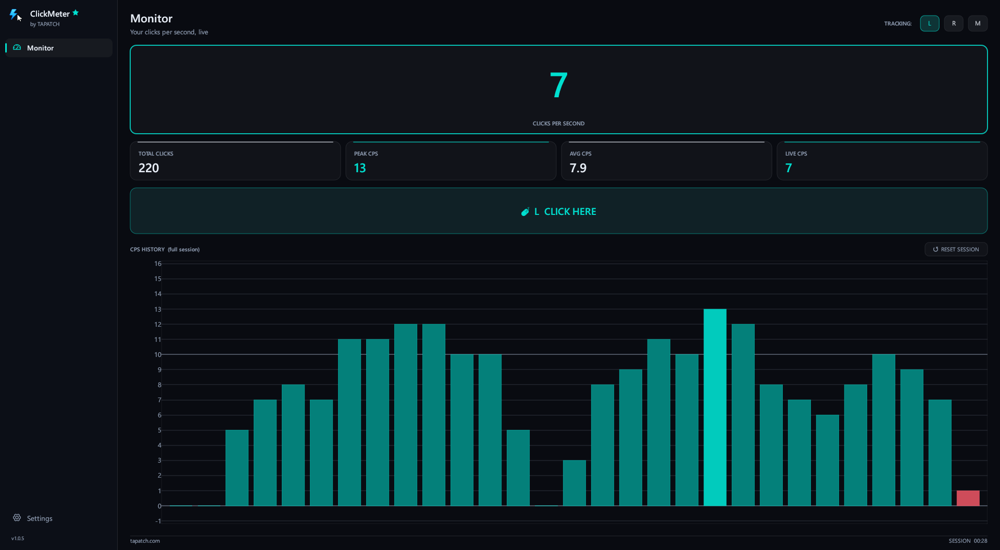
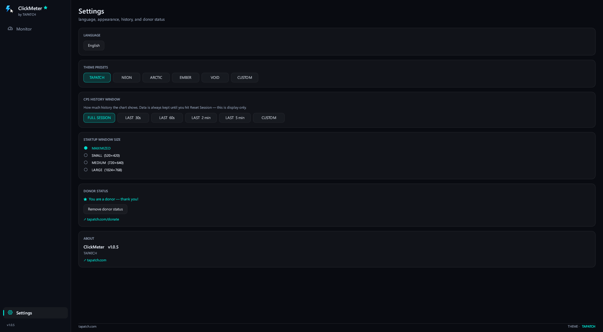

**ClickMeter 1.0.6** for Windows 10/11 (x64) · Free for personal use

### What's new

- Now runs on any Windows 10 or 11 PC, even a fresh install: it no longer needs the Microsoft Visual C++ Redistributable (no more "VCRUNTIME140.dll was not found")
- Nothing else changed

### Screenshots

 

### Video

### Download

**`ClickMeter-Setup-1.0.6.exe`** is attached below. It is the same file as on [tapatch.com/tools/clickmeter](https://tapatch.com/tools/clickmeter/).

### Security

- VirusTotal: **0 / 71** engines flag it · [view report](https://www.virustotal.com/gui/file/bb502d83f7a0b8d9f56d26af4f245cf88ba76432ea442ad47d043d52ded7e2b6/detection)
- SHA-256: `bb502d83f7a0b8d9f56d26af4f245cf88ba76432ea442ad47d043d52ded7e2b6`

*First released on tapatch.com on 2026-10-17.*

---
Free for personal use. Business or commercial use requires a paid license (see [tapatch.com/terms](https://tapatch.com/terms/)).
