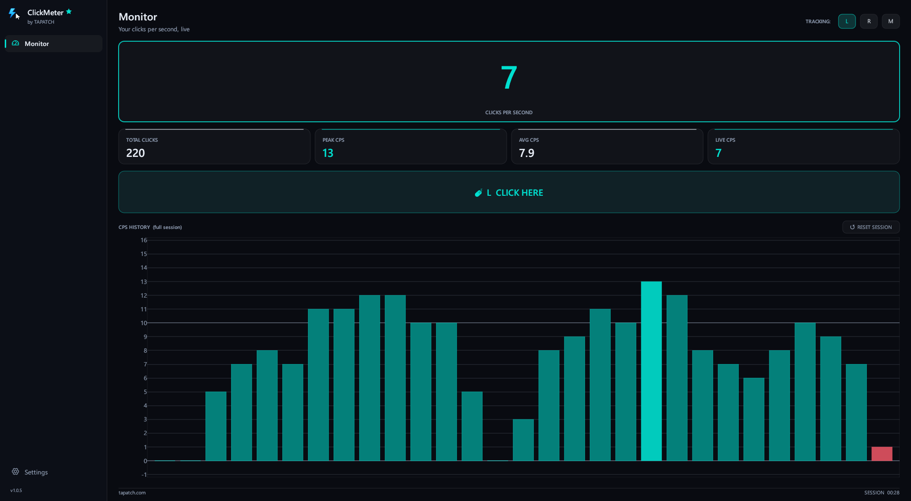
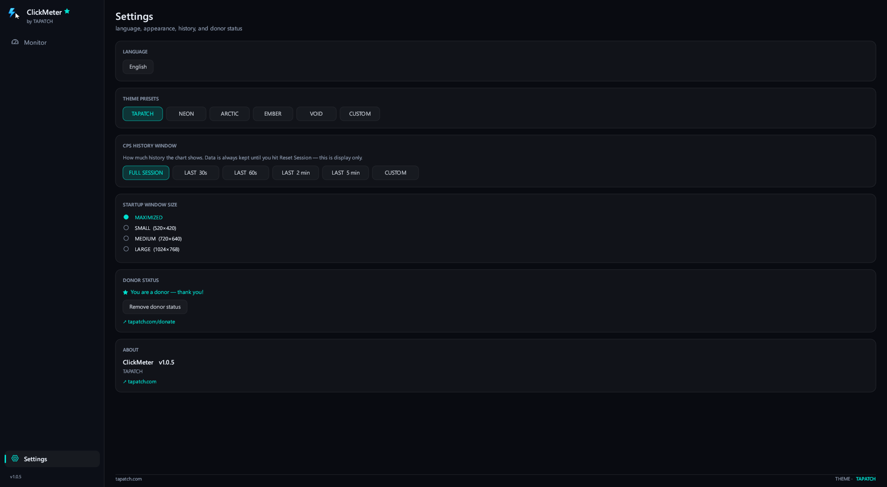

**ClickMeter 1.0.7** for Windows 10/11 (x64) · Free for personal use

### What's new

- Background pictures and GIFs: add as many as you like in Settings, tick the ones to show (or Select all), and the ticked ones take turns
- Sliders set how strong the picture is and how see-through the panels are; turn it off any time
- No longer crashes when opened within 35 seconds of Windows starting
- Much lighter on the PC: it redraws 4 times a second while no one is clicking instead of 125 (a click wakes it right away)
- Custom colors no longer come back one shade darker, and the donation pop-up is centered
- The installer's license text matches the current Terms, and THIRD-PARTY-NOTICES.txt lists the open-source parts it uses

### Screenshots

 

### Video

### Download

**`ClickMeter-Setup-1.0.7.exe`** is attached below. It is the same file as on [tapatch.com/tools/clickmeter](https://tapatch.com/tools/clickmeter/).

### Security

- VirusTotal: **1 / 71** engines flag it · [view report](https://www.virustotal.com/gui/file/5274d3d38c3db26ff885fa8ac262f0a45294bbfdef3bd8d35d66fade13e46809/detection)
- SHA-256: `5274d3d38c3db26ff885fa8ac262f0a45294bbfdef3bd8d35d66fade13e46809`

*First released on tapatch.com on 2026-11-04.*

---
Free for personal use. Business or commercial use requires a paid license (see [tapatch.com/terms](https://tapatch.com/terms/)).
