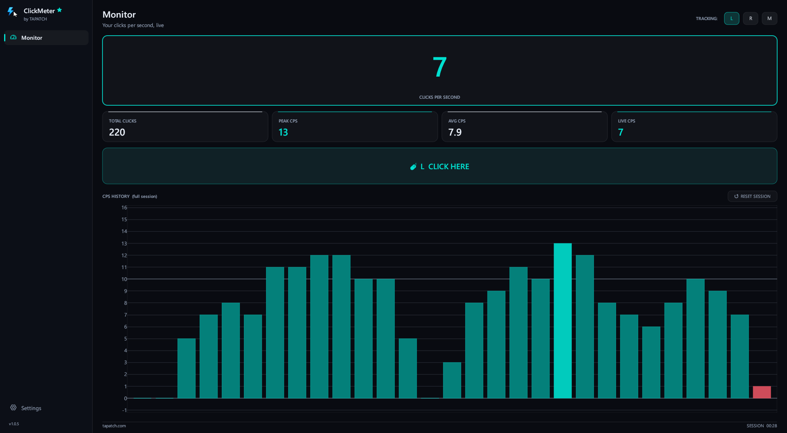
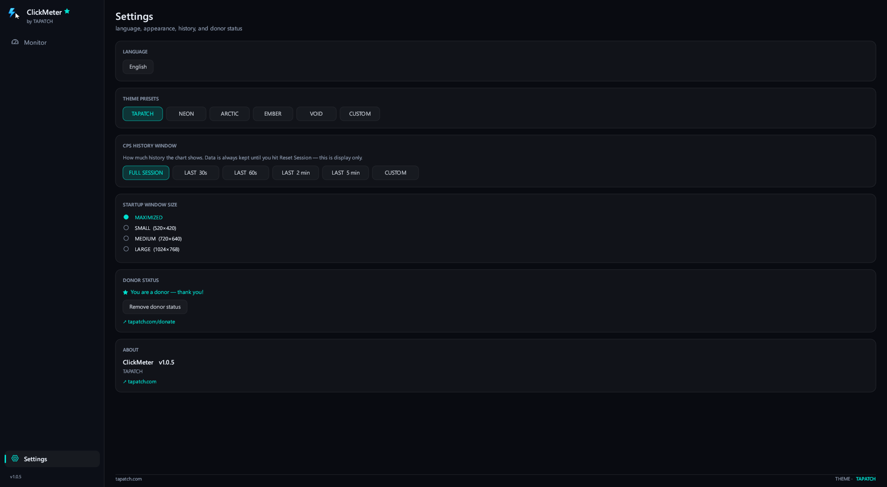

**ClickMeter 1.0.8** for Windows 10/11 (x64) · Free for personal use

### What's new

- The X on the donate pop-up's NOT YET button no longer shows as an empty box

### Screenshots

 

### Download

**`ClickMeter-Setup-1.0.8.exe`** is attached below. It is the same file as on [tapatch.com/tools/clickmeter](https://tapatch.com/tools/clickmeter/).

### Security

- VirusTotal: **1 / 71** engines flag it · [view report](https://www.virustotal.com/gui/file/2f835278ac490645c2a91ec2ed200abb895f1332c60bf07cf5a7d5b0ed3f59b6/detection)
- SHA-256: `2f835278ac490645c2a91ec2ed200abb895f1332c60bf07cf5a7d5b0ed3f59b6`

*First released on tapatch.com on 2026-11-07.*

---
Free for personal use. Business or commercial use requires a paid license (see [tapatch.com/terms](https://tapatch.com/terms/)).
